# Import layers (Basic omitted)

Lower layers are imported by higher ones. Max depth 13.

```mermaid
flowchart TB
  subgraph L0["Layer 0"]
    L0_AdmissibleGainsUnderP["AdmissibleGainsUnderP"]
    L0_Basic["Basic"]
    L0_IndexedFiltration["IndexedFiltration"]
    L0_Letter["Letter"]
    L0_Preliminaries["Preliminaries"]
    L0_SatisfiesNFLVR["SatisfiesNFLVR"]
    L0_Weight["Weight"]
  end
  subgraph L1["Layer 1"]
    L1_GeneratedFiltration["GeneratedFiltration"]
    L1_IsSpecialSemimartingale["IsSpecialSemimartingale"]
    L1_NflvrOfMartingaleMeasure["NflvrOfMartingaleMeasure"]
    L1_Weight_ConstOne["Weight.ConstOne"]
    L1_Weight_Geometric["Weight.Geometric"]
    L1_Word["Word"]
  end
  L0 -.-> L1
  subgraph L2["Layer 2"]
    L2_ExtTensorAlgebra_ExtTensorAlgebra["ExtTensorAlgebra.ExtTensorAlgebra"]
    L2_ExtTensorAlgebra_ShuffleWords["ExtTensorAlgebra.ShuffleWords"]
    L2_HypH2["HypH2"]
    L2_PureBrownianWord["PureBrownianWord"]
    L2_SmoothIteratedIntegral["SmoothIteratedIntegral"]
    L2_WordsOfLength["WordsOfLength"]
  end
  L1 -.-> L2
  subgraph L3["Layer 3"]
    L3_ExtTensorAlgebra_Coord["ExtTensorAlgebra.Coord"]
    L3_ExtTensorAlgebra_EvalShuffleBasis["ExtTensorAlgebra.EvalShuffleBasis"]
    L3_ExtTensorAlgebra_IsFinitelySupported["ExtTensorAlgebra.IsFinitelySupported"]
    L3_ExtTensorAlgebra_LevelNormSq["ExtTensorAlgebra.LevelNormSq"]
    L3_ExtTensorAlgebra_ShuffleBasis["ExtTensorAlgebra.ShuffleBasis"]
    L3_HypH3["HypH3"]
    L3_PriceFiltrationSignatureSpace["PriceFiltrationSignatureSpace"]
    L3_ProjLe["ProjLe"]
    L3_RightShift["RightShift"]
    L3_SmoothSignature["SmoothSignature"]
    L3_StratonovichHalfLaplacian["StratonovichHalfLaplacian"]
  end
  L2 -.-> L3
  subgraph L4["Layer 4"]
    L4_ExtTensorAlgebra_BasisWord["ExtTensorAlgebra.BasisWord"]
    L4_ExtTensorAlgebra_FreeTensorAlgebra["ExtTensorAlgebra.FreeTensorAlgebra"]
    L4_MemL2w["MemL2w"]
    L4_MemL2wInv["MemL2wInv"]
    L4_Norm2w["Norm2w"]
    L4_Norm2wInv["Norm2wInv"]
    L4_PriceFiltrationSignatureSpace_AugmentedMarketSpan["PriceFiltrationSignatureSpace.AugmentedMarketSpan"]
    L4_PriceFiltrationSignatureSpace_VInfty["PriceFiltrationSignatureSpace.VInfty"]
    L4_PriceFiltrationSignatureSpace_VSubspace["PriceFiltrationSignatureSpace.VSubspace"]
    L4_ShuffleFinite["ShuffleFinite"]
    L4_SuperfactorialFunctional["SuperfactorialFunctional"]
  end
  L3 -.-> L4
  subgraph L5["Layer 5"]
    L5_ExtTensorAlgebra_Antipode["ExtTensorAlgebra.Antipode"]
    L5_ExtTensorAlgebra_Concat["ExtTensorAlgebra.Concat"]
    L5_GKWDecompositionSetup["GKWDecompositionSetup"]
    L5_HypH1["HypH1"]
    L5_PriceFiltrationSignatureSpace_CompletenessDepth["PriceFiltrationSignatureSpace.CompletenessDepth"]
    L5_PriceFiltrationSignatureSpace_IsCompleteOnPriceFiltration["PriceFiltrationSignatureSpace.IsCompleteOnPriceFiltration"]
    L5_RiccatiOpBounded["RiccatiOpBounded"]
  end
  L4 -.-> L5
  subgraph L6["Layer 6"]
    L6_ExtTensorAlgebra_LevelNorm["ExtTensorAlgebra.LevelNorm"]
    L6_HypH1OfIsFinitelySupported["HypH1OfIsFinitelySupported"]
    L6_Lemma61GramPosDef["Lemma61GramPosDef"]
    L6_Proposition311SharpnessOfH1["Proposition311SharpnessOfH1"]
    L6_Proposition65NormalEquations["Proposition65NormalEquations"]
    L6_Section71BlackScholesCompleteness["Section71BlackScholesCompleteness"]
    L6_SignatureVolatilityModel["SignatureVolatilityModel"]
    L6_TheoremC["TheoremC"]
    L6_TheoremD["TheoremD"]
  end
  L5 -.-> L6
  subgraph L7["Layer 7"]
    L7_BlackScholesModel["BlackScholesModel"]
    L7_ExtTensorAlgebra_LevelInner["ExtTensorAlgebra.LevelInner"]
    L7_FirstOrderBrownianVolModel["FirstOrderBrownianVolModel"]
    L7_InfiniteGeometricSignatureModel["InfiniteGeometricSignatureModel"]
    L7_MemTw["MemTw"]
    L7_MemTwDual["MemTwDual"]
    L7_NormW["NormW"]
    L7_ProjGt["ProjGt"]
    L7_ProlongedBrownianSetup["ProlongedBrownianSetup"]
    L7_QuinticOUSignatureModel["QuinticOUSignatureModel"]
    L7_SignatureHestonLevel2Model["SignatureHestonLevel2Model"]
  end
  L6 -.-> L7
  subgraph L8["Layer 8"]
    L8_BanachAlgebraConcatBound["BanachAlgebraConcatBound"]
    L8_ChenIdentity["ChenIdentity"]
    L8_ClassicalRiccatiSolution["ClassicalRiccatiSolution"]
    L8_DualPairing["DualPairing"]
    L8_MemL2wInvOfMemTw["MemL2wInvOfMemTw"]
    L8_NormWDual["NormWDual"]
    L8_PriceFiltration["PriceFiltration"]
    L8_ProlongedBrownianSetup_BrownianFiltration["ProlongedBrownianSetup.BrownianFiltration"]
    L8_ProlongedBrownianSetup_WAug["ProlongedBrownianSetup.WAug"]
    L8_ProlongedBrownianSetup_WHat["ProlongedBrownianSetup.WHat"]
    L8_Tw["Tw"]
  end
  L7 -.-> L8
  subgraph L9["Layer 9"]
    L9_DualPairingLeNormWDualMulNormW["DualPairingLeNormWDualMulNormW"]
    L9_Lemma32SignatureInTw["Lemma32SignatureInTw"]
    L9_MemTwDualOfMemL2w["MemTwDualOfMemL2w"]
    L9_ProlongedBrownianSetup_SignatureFiltration["ProlongedBrownianSetup.SignatureFiltration"]
    L9_Remark219BlackScholesRiccati["Remark219BlackScholesRiccati"]
    L9_ShuffleIdentity["ShuffleIdentity"]
    L9_SignatureRiccatiKit["SignatureRiccatiKit"]
    L9_SignatureVolatilityModel_Sigma["SignatureVolatilityModel.Sigma"]
    L9_TailNorm2wInvLeRatioMulNormW["TailNorm2wInvLeRatioMulNormW"]
    L9_WeightedTruncationEstimates["WeightedTruncationEstimates"]
  end
  L8 -.-> L9
  subgraph L10["Layer 10"]
    L10_Corollary36SigmaWellDefined["Corollary36SigmaWellDefined"]
    L10_ItoCalculusKit["ItoCalculusKit"]
    L10_SignatureFiltrationEqBrownianFiltration["SignatureFiltrationEqBrownianFiltration"]
    L10_TheoremB["TheoremB"]
  end
  L9 -.-> L10
  subgraph L11["Layer 11"]
    L11_SignaturePriceSolution["SignaturePriceSolution"]
  end
  L10 -.-> L11
  subgraph L12["Layer 12"]
    L12_TheoremA["TheoremA"]
  end
  L11 -.-> L12
  subgraph L13["Layer 13"]
    L13_root["(root)"]
  end
  L12 -.-> L13
```

## Folder-level import counts (excluding Basic)

- `root` → `top-level`: 65 edges
- `top-level` → `ExtTensorAlgebra`: 57 edges
- `top-level` → `Weight`: 31 edges
- `ExtTensorAlgebra` → `top-level`: 23 edges
- `top-level` → `ProlongedBrownianSetup`: 18 edges
- `top-level` → `PriceFiltrationSignatureSpace`: 14 edges
- `root` → `ExtTensorAlgebra`: 13 edges
- `top-level` → `SignatureVolatilityModel`: 10 edges
- `ProlongedBrownianSetup` → `top-level`: 9 edges
- `root` → `PriceFiltrationSignatureSpace`: 6 edges
- `root` → `ProlongedBrownianSetup`: 5 edges
- `ProlongedBrownianSetup` → `ExtTensorAlgebra`: 4 edges
- `SignatureVolatilityModel` → `top-level`: 4 edges
- `root` → `Weight`: 3 edges
- `PriceFiltrationSignatureSpace` → `top-level`: 3 edges
- `root` → `SignatureVolatilityModel`: 2 edges
- `SignatureVolatilityModel` → `ExtTensorAlgebra`: 2 edges
- `SignatureVolatilityModel` → `ProlongedBrownianSetup`: 2 edges
- `PriceFiltrationSignatureSpace` → `ExtTensorAlgebra`: 1 edges
- `SignatureVolatilityModel` → `Weight`: 1 edges